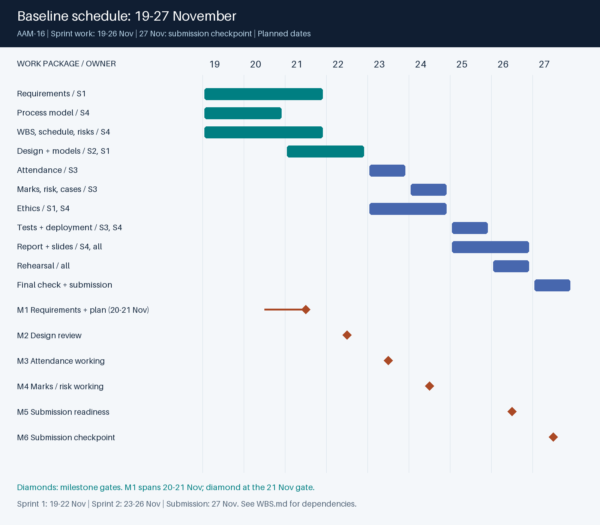
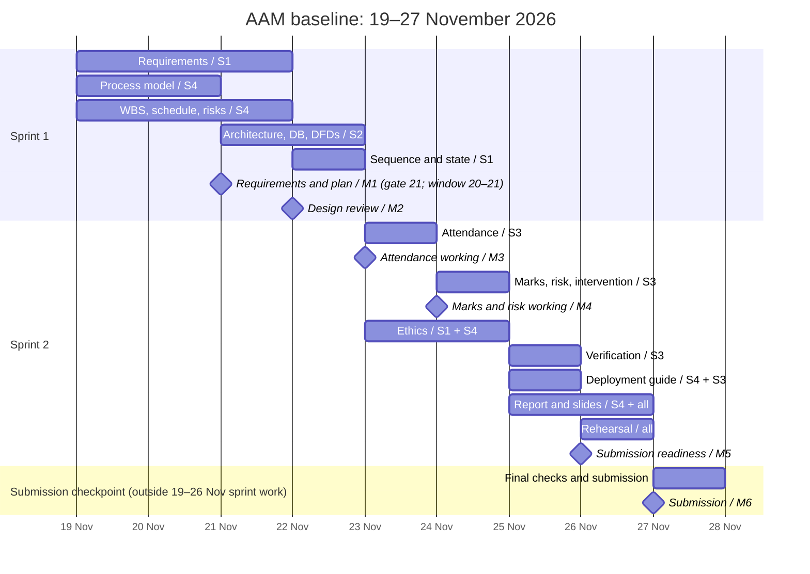

# Baseline Gantt chart (AAM-16)

Owner: S4 / Madiha Iram. Calendar dates: November 2026, from `PROJECT_PLAN.md`.
This is the baseline plan, not proof that work happened on these dates. Assignment due dates
for AAM-13–AAM-17 are 20/21 November; late preparation on 26 November must remain visible.

The chart marks all six gates. M1 retains its 20–21 November review window; its diamond
marks the closing gate on 21 November. Sprint work ends on 26 November; M6 is the separate
27 November submission checkpoint. Milestone markers describe the baseline, not acceptance evidence.

## Milestones and dependency gates

| Milestone | Baseline | Gate |
|---|---|---|
| M1 | 20–21 Nov | Requirements and plan accepted |
| M2 | 22 Nov | Schema/models aligned; Sprint 1 review |
| M3 | 23 Nov | Attendance slice working |
| M4 | 24 Nov | Marks and risk features ready for verification |
| M5 | 26 Nov | Tests, report, slides and rehearsal reviewed |
| M6 | 27 Nov | Final submission and receipt |

Design starts against available requirements on 21 November; final freeze waits for review.
Report outlining overlaps verification on 25 November, while results and slides are finalized
only after the selected revision is tested. Rehearsal on 26 November follows slide review.
See `WBS.md` for detailed predecessors. The diagram uses calendar days and does not imply
all tasks have equal effort or that each person can perform overlapping tasks simultaneously.

## Catch-up checkpoint: 26 November

Documentation is being prepared after its original due dates. The repository inspection found
an attendance prototype on main and separate PRs for SRS and marks/risk work. Prioritize the
required documents, validate the main demo, and state pending integration honestly. Keep
rehearsal and final review as explicit remaining gates. Do not redraw the baseline as if late
work had finished on time; add actual completion dates only when supported by evidence.
