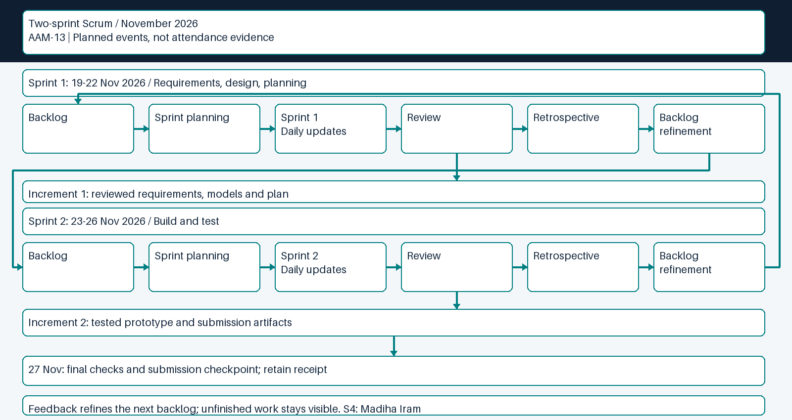
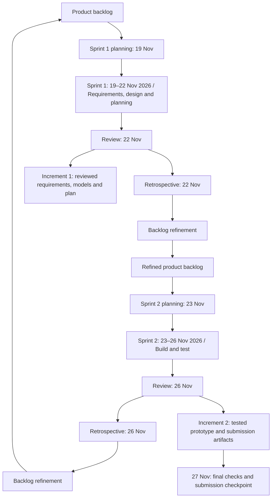

# Process model: two-sprint Scrum (AAM-13)

Owner: S4 / Madiha Iram. Baseline: 19–27 November 2026, from `PROJECT_PLAN.md`.
These dates describe the intended schedule; they are not a retrospective attendance log.

Editable source: [process-model.drawio](process-model.drawio). Open in draw.io / diagrams.net;
each event is a separate editable shape. `tools/build_submission.py` regenerates this source
and the PNG from one layout; preserve manual changes in the generator before rebuilding.

Daily progress/blocker updates take place within each sprint. Review inspects the increment;
retrospective improves the team's process; backlog refinement records feedback and unfinished work.

## Responsibilities and artifacts

This small academic team adapts Scrum rather than claiming a full-time commercial Scrum setup.
S1 clarifies stakeholder needs and the SRS. S4 coordinates priorities, schedule and blockers.
S2 and S3 deliver design, implementation and verification; all four inspect sprint outputs.
These role allocations do not assert a formally appointed Product Owner or Scrum Master.

| Event | Participants | Input | Output / evidence to retain |
|---|---|---|---|
| Sprint planning | All, coordinated by S4 | Prioritized product backlog, capacity, dependencies | Sprint goal and selected Jira tasks |
| Daily update | All | Work completed, next work, blockers | Dated board update or meeting note |
| Sprint review | All; stakeholder if available | Diagrams, documents or running prototype | Review comments and follow-up tasks |
| Retrospective | All | What helped, delayed or failed | One concrete improvement for next sprint |
| Backlog refinement | S4 with relevant owner | Feedback and incomplete items | Reprioritized tasks with acceptance conditions |

Sprint 1 goal: agree scope, requirements, architecture, database and plan. Exit requires
cross-checking entity names, DFD balancing and the attendance scenario before build work.
Sprint 2 goal: demonstrate attendance, verify the implementation available at submission,
and package the report, deployment guide and presentation. Unmerged features remain identified.

## Definition of Done

An artifact exists at its linked path, agrees with the SRS/design or explains deviations,
passes its relevant verification, references its Jira task in Git, and has a teammate review.
A code task also requires relevant tests. A rehearsal requires actual attendance and timing.
Moving a card or creating a file alone does not meet this definition.

## Feedback and late work

Review findings become backlog tasks, with priority given to correctness and required marks.
At the 26 November catch-up checkpoint, use the actual repository state rather than backdating
completion. Keep the original baseline visible, record remaining work, and preserve 27 November
for final checks. This model is supported by the existing project plan; meeting records must
be attached separately if the team has them.
