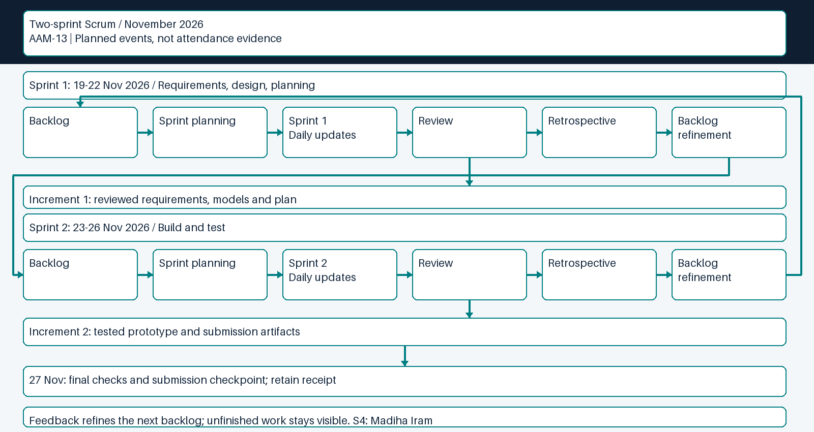
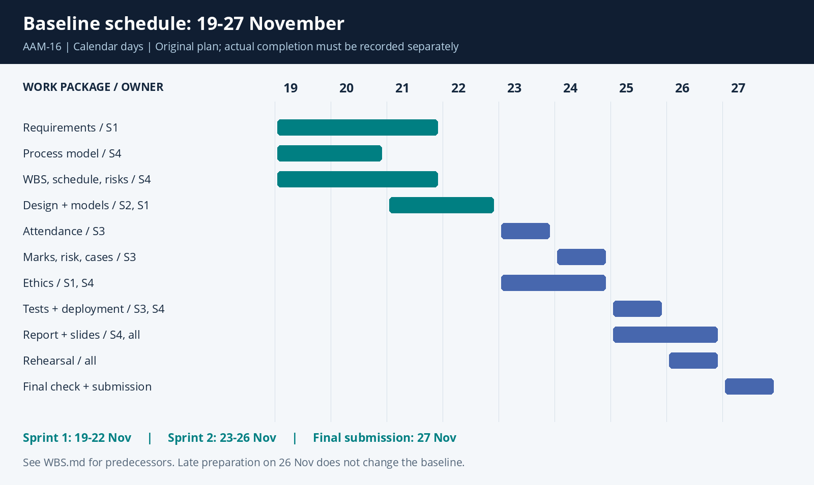

# Online Student Attendance & Academic Monitoring System

Software Engineering CCA project report • Prepared 26 November 2026

Documentation role: S4 / Madiha Iram. Team members for S1–S3 should be confirmed by the team;
role labels are retained rather than inventing names or signatures.

## Abstract

The proposed system brings attendance and internal assessment information into one place
so mentors can identify students who may need academic support before eligibility decisions.
The design covers five roles, explainable threshold rules, interventions and notifications.
The verified main-branch prototype implements an attendance slice in Flask and SQLite.
This report separates that runnable evidence from the broader design and unmerged work.
Two short Scrum sprints organize requirements/design and build/test work around the
27 November submission baseline. Process, planning, ethics and deployment artifacts accompany
the report. The system is an academic prototype using synthetic records, not a deployed
student information service.

## 1. Problem, users and scope

Registers and separate spreadsheets make it difficult to relate missed classes to internal
marks. A mentor may discover a problem too late to help. The objective is to record reliable
academic events, show current percentages and explain why support may be needed.

Admin maintains academic setup; Faculty enters attendance and marks; Mentor handles assigned
students' support cases; HOD oversees reports and thresholds; Student views their own records.
Parents have no login and receive contact only under an appropriate consent process.
Biometrics, RFID, face recognition, fees, timetable generation, ML prediction, mobile apps
and SMS are outside the planned scope.

The source plan proposes 75% attendance as a minimum, a warning band of 65–74.99%, attendance
below 65% as at-risk, a test below 40% as at-risk, and a multi-course rule for two or more
courses below a cutoff. These are configurable design assumptions, not verified universal
UGC rules or institutional eligibility decisions. Late counts as attended in the prototype.

## 2. Requirements and traceability

The plan enumerates FR1–FR15. The following table distinguishes design coverage and current
main behavior; the full proposed SRS is in PR #3 and requires its own review.

| Requirements | Intended behavior | Evidence / current limitation |
|---|---|---|
| FR1 | Login and five-role authorization | Users/roles in schema; main uses a demo identity picker |
| FR2 | Academic setup and CSV import | Schema and synthetic seed; no admin/import UI |
| FR3–FR4 | Sessions and P/A/L attendance | Working Flask form and records |
| FR5 | 48-hour attendance edit lock and audit | `is_locked`, `edit_attendance`, existing tests |
| FR6–FR7 | Assessment setup and valid marks | Schema; proposed runtime in PR #4 |
| FR8 | Recompute attendance percentage | `v_attendance_pct` and form tests |
| FR9–FR10 | Evaluate risk and notify on change | Design/seed only on main; PR #4 proposes rules and in-app alerts |
| FR11 | Mentor intervention lifecycle | Schema on main; proposed UI in PR #4 |
| FR12–FR14 | Student view, HOD reports, threshold editing | Design target; no complete main UI |
| FR15 | Audit every attendance/mark change | Attendance edits logged; do not claim full insert/mark audit coverage |

Security, privacy, mobile usability, accessibility, maintainability, backup and performance
requirements remain targets. Eight functional tests do not establish all non-functional
requirements. No survey results, measured performance results or stakeholder approvals
were found in the inspected main tree; none are invented in this report.

## 3. Process model and change rationale

The baseline chooses adapted Scrum: Sprint 1 on 19–22 November covers requirements, models
and planning; Sprint 2 on 23–26 November covers build, tests and the submission material.
Daily updates surface blockers; sprint reviews inspect outputs and retrospectives identify
improvements. S4 coordinates the work while all four roles review the increments.

The original idea of five increments over roughly six weeks did not fit the confirmed
27 November deadline. The supplied summary dates the switch to 19 November. The decision
rationale is supported by the repository plan, but meeting minutes are not available.
Scrum still delivers increments; the improvement sought is a shorter schedule and explicit
coordination/review points. No measured productivity improvement is claimed.

See [process model](../planning/PROCESS_MODEL.md) and
[justification](../planning/PROCESS_JUSTIFICATION.md) for events, tradeoffs and Done criteria.

## 4. Planning and scheduling

S1 owns requirements and behavioral models, S2 owns architecture/database/DFDs, S3 owns
implementation/tests, and S4 owns planning and documentation. The detailed WBS assigns
support roles, dependencies, dates and review conditions. Milestones are requirements/plan
on 20–21 November, design review on 22 November, attendance on 23 November, marks/risk on
24 November, readiness on 26 November and submission on 27 November.

The critical handoff sequence is requirements → design → attendance → marks/risk → tests →
final report → slides → rehearsal → submission. Report outlining and ethics may proceed in
parallel. These are baseline dates: preparing late documents on 26 November does not show
that their original 20/21 November deadlines were met. Actual progress must come from Git,
review and live board evidence. The risk register assigns probability/impact scores, owners,
triggers, prevention and contingency for scope, staffing, integration, privacy and demo risks.

## 5. Design

The architecture has a Bootstrap/server-rendered HTML presentation layer, Flask application
logic, and a relational data layer. SQLite supports development; a MySQL DDL exists for the
design target. SMTP is a planned external service. The runtime on main uses SQLite only.

The ER/schema includes users, faculty, students, courses, sections, enrollments, class sessions,
attendance records, assessments, mark entries, risk rules, flags/reasons, interventions,
notifications and audit records. Enrollment links students to sections; each section belongs
to a course and faculty member. Attendance is unique for each session/student pair, while
sessions are unique for section/date/period. Foreign keys and checks constrain stored data.

DFD Level 0 represents the five actors and the overall system. Level 1 separates academic
setup, attendance, marks, risk evaluation, intervention/notification and reports. Level 2
expands risk evaluation into fetching metrics, applying rules, comparing/updating flags and
raising alerts. Parent and child levels must preserve the same external inputs/outputs,
including reading current risk state. The dictionary describes metric formulas and rules.

The intended attendance scenario continues from entry through risk evaluation to mentor
support and eventual resolution. Main implements entry, validation, persistence, percentage
calculation and edit controls. The proposed state model adds Normal, Warning, At-Risk,
Under Intervention and Resolved, with human ownership of support cases.

Existing design exports are in `diagrams/`: architecture, DFD levels 0/1/2, ER and dictionary.
Their existence does not prove every designed flow is implemented. Sequence/state materials
are proposed in PR #3. Reconcile all models after any approved design change.

## 6. Implementation and demonstrable behavior

The verified code base is main commit `57c0c6a` (full identifier in the verification record).
This documentation branch does not merge another member's feature branch or alter app logic.
Faculty chooses a section, enters a date and period, and marks each enrolled student P/A/L.
The application saves a session and computes `(P + L) / recorded sessions × 100` through a view.
A duplicate date/period opens editing; changes within 48 hours are logged; older sessions lock.
The faculty selected for a different section receives 403.

The synthetic seed has Diya at 80% in CS501 (8 of 10). Marking her absent in the next class
yields 72.73% (8 of 11). Correcting that record to Present yields 81.82% (9 of 11).
Main does not compute a new Warning or send a mentor alert for that entry. Preloaded flag
rows are seed data, not evidence of runtime risk calculation.

PR #4 proposes marks, configurable risk evaluation, in-app notifications and mentor cases.
PR #3 proposes the SRS, sequence/state diagrams and ethics analysis. PR #5 proposes a
multi-course dictionary correction. Treat these as pending integration until their exact
revision has been reviewed, merged and tested; their claims are not this report's test result.

## 7. Verification and quality

The existing suite runs with `.venv/bin/python -m unittest discover -s src -v` and contains
8 attendance/page tests at the inspected revision. Checks cover seeded percentages and Late,
no-data behavior, new percentages, duplicate rejection, audit/lock behavior, invalid status,
section ownership and the submitted-form flow. Fresh execution results and a temporary-
database demonstration are recorded in [verification](VERIFICATION.md).

There is no main-branch verification here of secure login, student data isolation, risk and
marks behavior, SMTP, MySQL runtime support, load performance, accessibility conformance or
production recovery. These are follow-up verification areas. A branch containing 22 reported
tests does not mean main has 22 passing tests. The report records only checks actually run.

## 8. Ethics and professional responsibility

Student records should be private, accurate and accessible only for a defined purpose.
Labels must explain a support need rather than stigmatize. A mentor reviews context such
as medical leave, disability or sports duty; a rule must not automatically penalize a student.
Consent and data minimization govern any parent contact. The team should define retention,
review corrections and use audit evidence. Production security requires authenticated users,
appropriate authorization, CSRF protection, secure transport and tested backups.

The current identity picker permits impersonation by design for the demo. Synthetic data
and restricted local access are essential. The wider privacy/security commitments are in
[the proposed responsibility statement](PROFESSIONAL_RESPONSIBILITY.md), awaiting team
endorsement. DPDP applicability and legal compliance have not been independently verified.

## 9. Deployment, demonstration and maintenance

The deployment guide covers Python/venv setup, disposable SQLite initialization, local run,
expected demo values, test command, safe backup/reset and rollback. `init-db` is destructive
and must only target a disposable database. No public service or MySQL deployment is claimed.
The demo must use the verified revision and show only implemented behavior. Offline styling
may depend on the Bootstrap CDN; static backup material must be identified as such.

For future scale, verify access control and database migrations first, then measure concurrent
class writes and risk evaluation latency. Background notification delivery and indexing may
help after measurements identify bottlenecks. Do not infer a capacity guarantee from the
small synthetic dataset. Re-run verification whenever code is integrated.

## 10. Contributions and submission readiness

| Role | Planned responsibility | Evidence and review |
|---|---|---|
| S1 | Requirements, sequence/state models, ethics | PR #3 proposal; author/team review required |
| S2 | Architecture, DFDs, ER, schema, dictionary | Merged design PR #2; correction proposed in PR #5 |
| S3 | Attendance, marks/risk and tests | Attendance in main; further work proposed in PR #4 |
| S4 / Madiha Iram | Process, WBS/Gantt/risks, report, deployment, slides | This submission branch; reviewer sign-off pending |

This table records work allocation and visible artifacts, not equal effort, individual
attendance or endorsement. Drafts prepared with an assistant require the named contributors'
review. AAM-37 needs a real timed rehearsal with all speakers. Board status, institutional
requirements, final contributor details and the actual submission receipt remain team checks.

## References and artifact index

- Repository baseline: [attendance-academic-monitor](https://github.com/sahid-alam/attendance-academic-monitor), main `57c0c6a`.
- Internal primary source: `planning/PROJECT_PLAN.md`; code/schema/tests under `src/`.
- Design: `diagrams/README.md` and `diagrams/data_dictionary.md`.
- Process: `planning/PROCESS_MODEL.md`, `planning/PROCESS_JUSTIFICATION.md`.
- Planning: `planning/WBS.md`, `planning/GANTT.md`, `planning/RISK_REGISTER.md`.
- Presentation: `presentation/SLIDES.md`, `presentation/REHEARSAL.md`.
- [Scrum Guide, 2020](https://scrumguides.org/scrum-guide.html), framework reference.
- [ACM Code of Ethics](https://www.acm.org/code-of-ethics), professional principles.
- [Flask deployment guidance](https://flask.palletsprojects.com/en/stable/deploying/), production server guidance.

The external links are references for team follow-up, not a claim they were independently
validated during this repository inspection. Unverified secondary legal/attendance claims
from the plan are not treated as institutional policy in this report.
