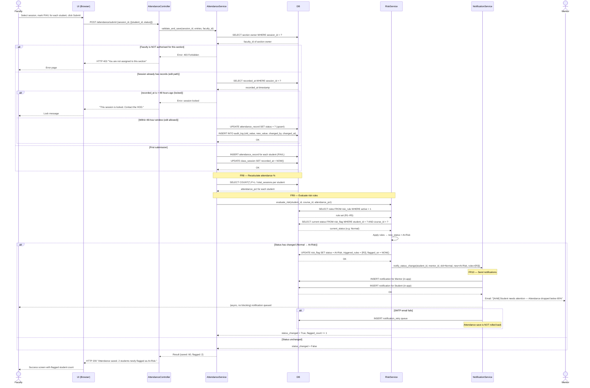

# Sequence Diagram: Faculty Submits Attendance
## Online Student Attendance & Academic Monitoring System

**Author:** S1 – Requirements & Analysis Lead  
**Version:** 1.0 | **Date:** 22 November 2026  
**Scenario:** The core scenario that runs through the DFD Level 2, state diagram, code, and live demo.

---

## Participants

| Participant | Role |
|---|---|
| Faculty | The user who submits the attendance list |
| UI (Browser) | The HTML page rendered by Flask/Bootstrap |
| AttendanceController | The Flask route handler (`POST /attendance/submit`) |
| AttendanceService | Business logic: validate, save, calculate % |
| DB | SQLite / MySQL database (stores D3, D6, D7) |
| RiskService | Business logic: apply risk rules (FR9) |
| NotificationService | Business logic: send in-app + email alerts (FR10) |
| Mentor | Receives the status-change notification |

---

## Sequence Diagram (Mermaid)

---

## Normal Flow — Step-by-Step Description

| Step | Actor | Description |
|---|---|---|
| 1 | Faculty | Selects the session and marks each of the 60 enrolled students P, A, or L. Clicks Submit. |
| 2 | UI | Sends a POST request to `AttendanceController` with the session ID and the full status list. |
| 3 | AttendanceController | Delegates to `AttendanceService` with the faculty's identity from the session. |
| 4 | AttendanceService | Verifies the faculty is assigned to the section. |
| 5 | AttendanceService | Verifies the session is not locked. |
| 6 | AttendanceService | Saves all attendance records; sets `recorded_at` if this is the first submission. |
| 7 | AttendanceService | Recalculates attendance % for every student in the section (FR8). |
| 8 | RiskService | Fetches active rules, reads current risk flags, applies rules, and determines the new status for each student. |
| 9 | RiskService | For students whose status changed: updates D6 and calls `NotificationService`. |
| 10 | NotificationService | Writes in-app notifications to D7 and sends emails to the mentor and student. |
| 11 | AttendanceController | Returns a success response: "Attendance saved. 2 students newly flagged." |
| 12 | UI | Displays the success screen to the faculty. |

---

## Alternative and Error Flows

| Flow | Trigger | Outcome |
|---|---|---|
| **A — Unauthorised faculty** | Faculty does not teach the selected section | HTTP 403 returned immediately. No data written. |
| **B — Duplicate submission (edit)** | Attendance already recorded; within 48-hour window | Existing records are updated (upsert). Audit log entry written. Risk re-evaluated. |
| **C — Locked session** | Attendance is older than 48 hours | Edit rejected. Error message shown. Faculty directed to HOD. Rejected attempt logged in audit log. |
| **D — Notification failure** | SMTP server unreachable | Attendance and risk flag saved normally. Email queued in `notification_retry` table. Faculty sees no error message. |

---

## Notes for the Demo

- This diagram covers **FR4, FR5, FR8, FR9, FR10, and FR15** in one flow.
- During the live demo, S3 runs the code while S1 narrates using this diagram.
- The "2 students newly flagged" message on the success screen is the observable output of the whole pipeline.
