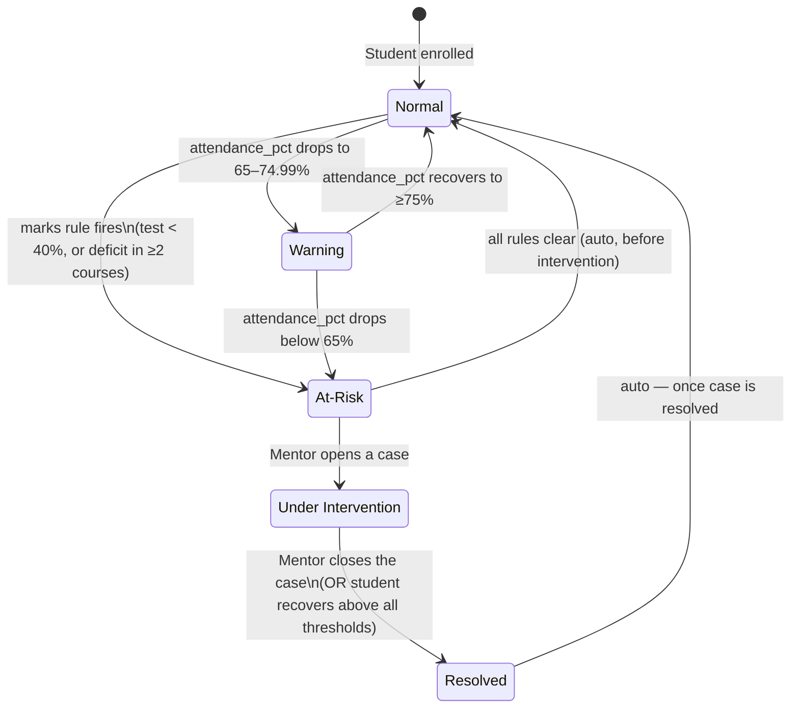

# Student Status State Transition Diagram
## Online Student Attendance & Academic Monitoring System

**Author:** S1 – Requirements & Analysis Lead  
**Version:** 1.0 | **Date:** 22 November 2026

---

## States

| State | Meaning |
|---|---|
| **Normal** | Attendance ≥ 75 % and no marks rule firing. No action needed. |
| **Warning** | Attendance in the 65 – 74.99 % condonation band. Student is approaching the threshold. |
| **At-Risk** | Attendance < 65 %, or any test below 40 % of its maximum, or below the cutoff in ≥ 2 courses. Immediate attention required. |
| **Under Intervention** | Mentor has opened an active intervention case. |
| **Resolved** | The mentor has closed the case (or the student recovered above all thresholds). |

---

## State Transition Diagram (Mermaid)



---

## Transition Table

| From | To | Trigger | Actor |
|---|---|---|---|
| *(start)* | Normal | Student is enrolled in a course | System (enrollment) |
| Normal | Warning | attendance_pct recalculated and falls into 65 – 74.99 % | System (FR8 + FR9) |
| Normal | At-Risk | A marks rule fires: any test < 40 % of max, or deficit in ≥ 2 courses | System (FR9) |
| Warning | At-Risk | attendance_pct falls below 65 % | System (FR8 + FR9) |
| Warning | Normal | Student attends enough classes; attendance_pct recovers to ≥ 75 % | System (FR8 + FR9) |
| At-Risk | Normal | All risk rules clear (student recovered without an intervention being opened) | System (FR9, automatic) |
| At-Risk | Under Intervention | Mentor opens an intervention case (FR11) | Mentor |
| Under Intervention | Resolved | Mentor marks the case closed (FR11), or student's data crosses back above all thresholds | Mentor / System |
| Resolved | Normal | Case is resolved; FR9 re-evaluates and finds no active rules firing | System (FR9, automatic) |

---

## Important Rules

1. **At-Risk overrides Warning.** If both conditions are true (attendance in warning band AND a marks rule fires), the system stores At-Risk, not Warning.
2. **Automatic recovery.** A student can move from Warning or At-Risk directly back to Normal without any manual intervention if their data improves (e.g., after approved leave is excluded).
3. **HOD override.** The HOD can manually unlock a locked attendance record (FR5), which triggers FR8 and FR9 again and may cause a state change.
4. **Notifications** are sent on every state change that involves the student or mentor (FR10).
5. **The at-risk label** is never shown publicly. Only the student, their assigned mentor, and the HOD can see it.

---

## Relationship to the Core Demo Scenario

The demo traces this path through the diagram:

```
Normal  →  At-Risk  →  Under Intervention  →  Resolved  →  Normal
```

1. Faculty submits attendance → FR8 recalculates → FR9 fires R3 (attendance < 65 %) → **Normal → At-Risk**
2. Mentor receives notification → opens a case → **At-Risk → Under Intervention**
3. Student attends remedial classes; mentor closes the case → **Under Intervention → Resolved → Normal**
