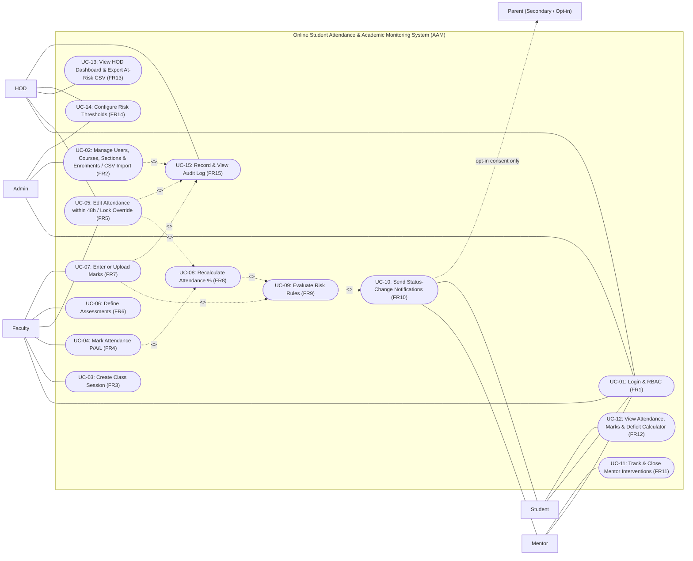

# Use Case Diagram
## Online Student Attendance & Academic Monitoring System

| Field | Detail |
|---|---|
| Jira issue | **AAM-12** |
| Document version | 1.0 |
| Date | 25 November 2026 |
| Author | S1 – Requirements & Analysis Lead |
| Matches | `requirements/SRS.md` (FR1 – FR15) and DFD Level 1 (AAM-22) |

---

## 1. UML Use Case Diagram (Mermaid)

---

## 2. Actors Overview

| Actor | Type | Summary of Responsibilities |
|---|---|---|
| **Admin** | Primary | Authenticates (FR1), manages users/courses/sections/enrolments including CSV bulk imports (FR2), and configures risk thresholds (FR14). |
| **Faculty** | Primary | Authenticates (FR1), creates class sessions (FR3), marks `P/A/L` attendance (FR4), edits within the 48-hour window (FR5), defines assessments (FR6), and enters/uploads marks (FR7). |
| **Mentor** | Primary | Authenticates (FR1), receives risk-change alerts (FR10), opens intervention cases (`Counselling`, `Remedial class`, etc.), and closes resolved cases (FR11). |
| **HOD** | Primary | Authenticates (FR1), views department dashboard and exports at-risk CSVs (FR13), sets risk rules (FR14), views `audit_log` (FR15), and overrides locked sessions (> 48 h) (FR5). |
| **Student** | Primary | Authenticates (FR1), views own attendance %, marks, private risk status, and classes-needed deficit calculator (FR12), and receives status-change notifications (FR10). |
| **Parent** | Secondary | Has **no login** to AAM. Receives email notifications only when `students.parent_consent = 1` (student opt-in). |

---

## 3. Use Case to Requirement (FR1 – FR15) Mapping

| Use Case ID | Use Case Name | Mapped FR | Primary Actor(s) | DFD Process |
|---|---|---|---|---|
| **UC-01** | Login & RBAC | FR1 | Admin, Faculty, Mentor, HOD, Student | 1.0 |
| **UC-02** | Manage Users, Courses, Sections & Enrolments | FR2 | Admin | 1.0 |
| **UC-03** | Create Class Session | FR3 | Faculty | 2.0 |
| **UC-04** | Mark Attendance (`P/A/L`) | FR4 | Faculty | 2.0 |
| **UC-05** | Edit Attendance (48h Window) / Lock Override | FR5 | Faculty, HOD | 2.0 |
| **UC-06** | Define Assessments | FR6 | Faculty | 3.0 |
| **UC-07** | Enter or Upload Marks | FR7 | Faculty | 3.0 |
| **UC-08** | Recalculate Attendance % | FR8 | System (triggered by UC-04 / UC-05) | 2.0 / 4.0 |
| **UC-09** | Evaluate Risk Rules | FR9 | System (triggered by UC-07 / UC-08) | 4.0 |
| **UC-10** | Send Status-Change Notifications | FR10 | System → Mentor, Student, Parent (opt-in) | 5.0 |
| **UC-11** | Track & Close Mentor Interventions | FR11 | Mentor | 5.0 |
| **UC-12** | View Attendance, Marks & Deficit Calculator | FR12 | Student | 6.0 |
| **UC-13** | View HOD Dashboard & Export At-Risk CSV | FR13 | HOD | 6.0 |
| **UC-14** | Configure Risk Thresholds | FR14 | HOD, Admin | 1.0 |
| **UC-15** | Record & View Audit Log | FR15 | System (write), HOD (read-only) | All |

---

## 4. Key `<<include>>` and `<<extend>>` Relationships

1. **Attendance → Recalculation → Risk Engine (`<<include>>`):** Every attendance submission (`UC-04`) or 48-hour edit (`UC-05`) includes `UC-08` (recalculate `attendance_pct`), which in turn includes `UC-09` (evaluate `risk_rules`).
2. **Marks Entry → Risk Engine (`<<include>>`):** Entering or updating assessment marks (`UC-07`) automatically triggers `UC-09` (`test_pct < 40` and `courses_below_cutoff >= 2`).
3. **Risk Engine → Notifications (`<<extend>>`):** `UC-10` runs only when `UC-09` detects an actual status change (e.g., `NORMAL → WARNING` or `NORMAL → AT_RISK`).
4. **Modifications → Audit Log (`<<include>>` / `<<extend>>`):** Attendance edits (`UC-05`) always record an `audit_log` entry (`UC-15`); updates to marks (`UC-07`) and admin setup (`UC-02`) also log changes to `audit_log`.
